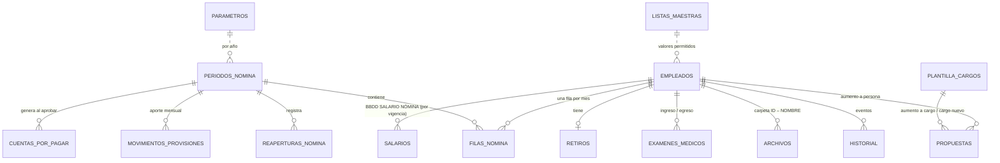

# Brutal OS — Arquitectura

## 1. Stack

| Capa | Hoy (demo navegable) | Producción |
|---|---|---|
| Frontend | React 18 + TypeScript + Vite, React Router (hash) | Igual |
| Diseño | Sistema propio en CSS (tokens, Liquid Glass, modo oscuro). Sin Tailwind/shadcn: el look de Apple requiere control fino de blur, especulares, radios concéntricos y tipografía SF | Igual |
| Gráficas | Recharts | Igual |
| Excel | SheetJS (`xlsx`): exportar tablas, importar la BBDD actual, archivo de dispersión | Igual |
| Datos | Repositorio en el navegador (`src/data/store.ts`) + IndexedDB para archivos | Supabase: PostgreSQL + RLS + Storage privado con URLs firmadas |
| Auth | Selector de rol (“Ver como”) | Supabase Auth con correo corporativo, sesiones con expiración |
| OTP | Código de 6 dígitos mostrado en pantalla | Edge Function que envía el código por correo/SMS; hash + expiración + un solo uso |
| Deploy | Vercel (`brutal-os/vercel.json`) | Vercel |

**Por qué Vite y no Next.js por ahora.** El repositorio ya despliega una SPA Vite en Vercel y la
demo debía funcionar sin credenciales de base de datos. Toda la lógica de negocio vive en
`src/domain/` como funciones puras y probadas, y todas las escrituras pasan por las acciones de
`src/data/store.ts`. Migrar a Supabase es reemplazar ese repositorio por llamadas a la base de
datos; las pantallas no cambian. Si se prefiere Next.js (App Router) para server actions, el
dominio y los componentes se mueven tal cual.

## 2. Modelo de datos (ER)



Tablas, tipos, restricciones y políticas RLS completas: [`supabase/schema.sql`](../supabase/schema.sql).

Principios aplicados:
- **Una sola fuente de verdad.** El empleado se crea una vez (ID `LB0001`). El salario vive en
  `salarios`, enlazado solo por ID; la nómina toma datos bancarios y cargo de la BBDD de empleados.
- **Nada se borra.** Retiros cambian estatus; soft delete (`archivado_en`) en todo.
- **Trazabilidad.** `historial` guarda quién, qué, cuándo, valor anterior y nuevo. Es la fuente
  de las gráficas mensuales.
- **Parametrizable.** Ningún valor legal está en el código: `parametros` por año.
- **Datos sensibles.** Cuenta bancaria cifrada (solo ADMINISTRADOR descifra); en vistas generales
  se enmascaran documento y cuenta.

## 3. Mapa de navegación

```
Inicio ─ hero de nómina del mes, alertas, KPIs, shelf de módulos, accesos rápidos
Empleados
 ├ Resumen      KPIs + 12 gráficas + alertas + contratos por vencer
 ├ Directorio   tarjetas con foto / tabla ordenable · semáforo de documentos
 ├ Retirados    separados de los activos · liquidación · examen de egreso
 ├ Socios       solo ADMINISTRADOR
 ├ Historial    log completo con filtros
 ├ Ficha 360°   datos, contrato, examen, documentos por carpeta, salario, nóminas, línea de tiempo
 ├ Nuevo empleado (7 pasos, borrador automático, Ley 1581) · Importar Excel · Exportar Excel
Nómina
 ├ Resumen            neto a consignar + provisiones (protagonistas) · 8 gráficas · mes/año
 ├ Nómina mensual     flujo BORRADOR→CARGADO→EN APROBACIÓN→APROBADO→ENVIADO A PAGOS · novedades · desprendibles
 ├ Plantilla por cargo
 ├ Simulador          aumento persona / cargo / cargo nuevo · antes vs después
 ├ Propuestas         aprobar / rechazar / devolver
 ├ Provisiones        saldo, causado vs pagado, pagos de prima y cesantías
 ├ Pagos generados    cuentas por pagar · archivo de dispersión
 └ Ingresos mensuales
Configuración ─ Parámetros por año · Listas maestras · Roles · Respaldo
Coming soon ─ RRHH · Pagos · Facturación · Impuestos · Clientes · Terceros · Índice documental · Legal · Reportes
```

## 4. Gráficas y la pregunta que responden

**Empleados** (sin socios)
| Gráfica | Pregunta |
|---|---|
| Activos vs. retirados (líneas) | ¿Estamos creciendo o perdiendo gente? |
| Ingresos vs. retiros por mes (barras) | ¿Cuánto movimiento de personal hay cada mes? |
| Rotación mensual % | ¿La rotación está bajo control? |
| Tipo de contrato (dona) | ¿Cuánta gente sigue por prestación de servicios? |
| Por área / por cargo | ¿Dónde está concentrado el equipo? |
| Antigüedad | ¿Retenemos a la gente más allá de los primeros meses? |
| EPS · pensión · banco | ¿Con qué entidades tramitamos más afiliaciones y pagos? |
| Rango de edades | ¿Cómo es el perfil generacional del equipo? |
| Motivos de retiro | ¿Por qué se va la gente? |
| Estatus de examen médico | ¿Quién no tiene examen de ingreso al día? |

**Nómina** (sin socios, por mes o por año)
| Gráfica | Pregunta |
|---|---|
| Total nómina mes a mes + variación % | ¿Cuánto crece el costo y a qué ritmo? |
| Ingresos vs. nómina + % | ¿Qué parte de lo facturado se va en nómina? |
| Costo empresa desglosado | ¿En qué se va cada peso: salario, auxilios, seguridad social, provisiones, deducciones asumidas? |
| Nómina por área | ¿Qué área pesa más? |
| Costo promedio por empleado | ¿Sube el costo por persona? |
| Provisiones: saldo vs. pagos | ¿Alcanza lo ahorrado para prima y cesantías? |
| Proyección 12 meses | ¿Cuánto costará la nómina el próximo año con contratos, aumentos y SMMLV? |

## 5. Reglas implementadas (de las instrucciones de la hoja)

Empleados: ID consecutivo, listas cerradas, cargo dependiente del área, MAYÚSCULAS, fechas
DD/MM/AAAA, celulares de 10 dígitos, obligatorios vacíos en amarillo, duplicados por documento
(actualizar o reactivar con el mismo ID), carpeta y nombres estándar (`LB0012_CEDULA.pdf`),
terminación FIJO calculada, renovaciones (máx. 3 de 6 meses; desde la 4.ª mínimo 12), prórroga
automática registrada como “Renovación automática por falta de preaviso”, retiro con causal,
liquidación y soportes, examen de egreso automático, flujo de examen médico con cita y
certificado obligatorio, alertas (FIJO ≤ 45 días, documentos a 5 días, liquidaciones, exámenes,
cumpleaños), roles y enmascaramiento.

Nómina: fórmulas validadas de la hoja replicadas y cubiertas por pruebas, PARÁMETROS por año,
LISTAS MAESTRAS, deducciones asumidas, alerta de base < SMMLV, plantilla por cargo, simulador con
comparativo, propuestas, nómina mensual por persona con novedades (prorrateo, incapacidades,
licencias, vacaciones, horas extra, bonificaciones, préstamos y anticipos), sección NÓMINA SOCIOS,
carga por fila, aprobación con código de un solo uso, bloqueo y reapertura con código, envío a
Pagos (neto por persona, provisiones, planilla con fecha PILA), archivo de dispersión, provisiones
con pagos de prima/cesantías, INGRESOS MENSUALES y proyección.

## 6. Decisiones tomadas y preguntas abiertas

1. **Cargos duplicados.** Se conservaron los nombres de la BBDD de empleados (DIRECTOR
   ADMINISTRATIVO Y COMERCIAL, DIRECTOR DE MARKETING, DIRECTOR DISEÑO) y se agregaron los que solo
   existían en nómina (CONTENT MANAGER JR/SR, DISEÑADOR SEMI JR/SR, TRAFFICKER SR). El importador
   traduce los nombres viejos. ¿Confirmas?
2. **Inconsistencias de la hoja de nómina.** En algunas filas `TOTAL DEDUCCIONES` = salud + pensión
   (sin FSP ni retención) y la fila 9 suma la planilla completa al costo. Se aplicó la regla escrita
   en las instrucciones: deducciones = salud + pensión + FSP + retención; costo = bruto + aporte
   empleador + provisiones.
3. **Deducciones asumidas.** Literalmente: se siguen descontando al empleado y su valor se suma al
   costo. ¿La empresa le devuelve ese valor al empleado por otra vía (entonces debería sumar al
   neto a consignar)?
4. **Auxilio de transporte.** Se replicó `base < 2 SMMLV` como en la hoja. La ley dice “hasta 2
   SMMLV” (≤). Solo cambia el caso exacto de 2 SMMLV.
5. **Auxilio no prestacional.** La hoja tiene excepciones (0 % en algunos cargos del mínimo, 25 %
   para DISEÑADOR con $1.800.000). Quedó configurable por cargo y por persona, con la regla 25 %/35 %
   por defecto.
6. **Retención en la fuente.** Manual por persona (como hoy) con opción de cálculo por
   Procedimiento 1. Los $712.000 de los socios no coinciden con el Procedimiento 1 estándar:
   ¿incluyen dependientes, medicina prepagada o intereses de vivienda?
7. **Contratos PS en nómina.** La hoja liquida a todos con la misma fórmula laboral. Se mantuvo; el
   tipo PS se puede marcar como obsoleto en Configuración cuando desaparezca.
8. **Día hábil de PILA.** Depende de los dos últimos dígitos del NIT: ¿cuáles son?
9. **Socios en el flujo de carga.** COORDINACIÓN no ve datos de socios, así que sus filas entran
   cargadas y las gestiona el ADMINISTRADOR.
